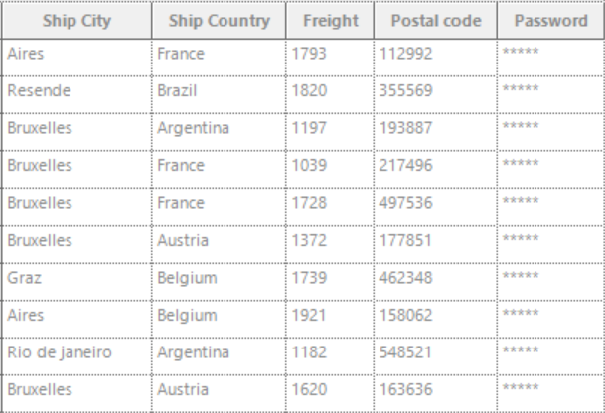

# How to show the password column in WinForms GridGroupingControl?

The password column character for the [WinForms GridGroupingControl](https://help.syncfusion.com/windowsforms/gridgrouping/overview) can be set by using the [PasswordChar](https://help.syncfusion.com/cr/windowsforms/Syncfusion.Windows.Forms.Grid.GridStyleInfo.html#Syncfusion_Windows_Forms_Grid_GridStyleInfo_PasswordChar) property. The password column character can also be set by using the [QueryCellStyleInfo](https://help.syncfusion.com/cr/windowsforms/Syncfusion.Windows.Forms.Grid.Grouping.GridGroupingControl.html#Syncfusion_Windows_Forms_Grid_Grouping_GridGroupingControl_QueryCellStyleInfo) event handler also.

 

### By using the GridColumnDescriptor:

In the following code example, the password character of the Password column is set by using the **PasswordChar** property.

### C#
```csharp
//Sets the password column character by using the PasswordChar property of the TableDescriptor.
this.gridGroupingControl1.TableDescriptor.Columns["Password"].Appearance.AnyRecordFieldCell.PasswordChar = '*';
```
### VB
```vb
'Sets the password column character by using the PasswordChar property of the TableDescriptor.
Me.gridGroupingControl1.TableDescriptor.Columns("Password").Appearance.AnyRecordFieldCell.PasswordChar = "*"c
```
### By using the QueryCellStyleInfo Event:


In the following event handler, the password character of the Grid Grouping control is set for the Password column.

### C#
```csharp
//Event subscription
this.gridGroupingControl1.QueryCellStyleInfo += GridGroupingControl1_QueryCellStyleInfo; 
 
//Eventcustomization
private void GridGroupingControl1_QueryCellStyleInfo(object sender, GridTableCellStyleInfoEventArgs e)
{
    if (e.TableCellIdentity.Column != null && e.TableCellIdentity.Column.Name == "Password")
    {
        e.Style.PasswordChar = '*';
    }
}
```
### VB
```vb
'Event subscription
AddHandler Me.gridGroupingControl1.QueryCellStyleInfo, AddressOf GridGroupingControl1_QueryCellStyleInfo 
 
'Eventcustomization
Private Sub GridGroupingControl1_QueryCellStyleInfo(ByVal sender As Object, ByVal e As GridTableCellStyleInfoEventArgs)
    If e.TableCellIdentity.Column IsNot Nothing AndAlso e.TableCellIdentity.Column.Name = "Password" Then
        e.Style.PasswordChar = "*"c
    End If
End Sub
```

The screenshot below illustrates the password column in **GridGroupingControl**


